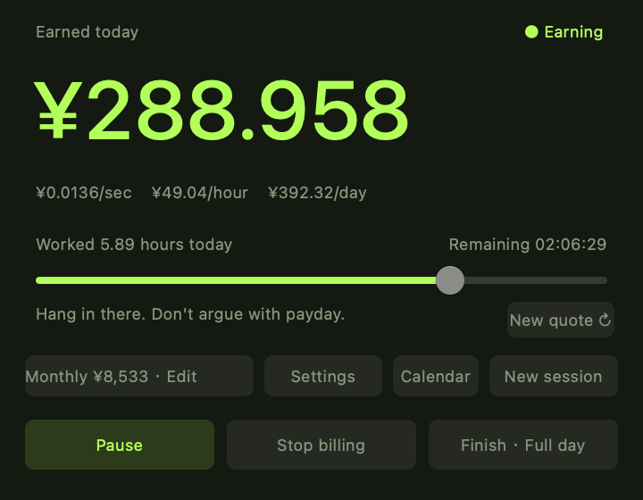

# Work Cheer · 上班鼓励器

English · [中文](README.md)

**For entertainment only. Commercial use is prohibited.**

## How much has this workday earned?

**Keep today's pay on your desktop. Hours worked and estimated earnings, at a glance.**

A little Mac window that turns your monthly salary or daily pay into a live earnings counter. Set your pay, start work, and watch the number grow. Pause for a break. Log the day when you're done.

> Hang in there. Don't argue with payday.

**[↓ Download for Mac — free](https://github.com/CUICAN-fafa/work-cheer/raw/refs/heads/main/Work-Cheer-Mac.zip)**

No account · Your pay stays on your Mac · English / 中文 · macOS 12+ · Apple silicon + Intel



## A little something to look forward to

**See what today's hours add up to.**
Your estimated earnings in big type, with your hourly rate and time remaining nearby. Shrink it into a desktop corner and glance over when you feel like it.

**Take a break. Call it a day.**
Pause freezes the counter. Stop tracking keeps what you've earned so far. Log full day records the daily pay you configured. You set the pace.

**Started work before you started the timer?**
Drag the slider to catch up. Hours, earnings and time remaining update together, with one-minute precision.

**Look back at your month.**
The work calendar keeps each day's check-ins, tracked hours and estimated earnings. Starting a new session keeps the previous record.

**A little humor in your corner.**
Twenty rotating workday quotes, with a button to swap the current one. Move, resize or pin the window, from a tiny widget to a desktop-filling view.

## Get started in three steps

1. **Unzip and open.** Move the app into Applications.
2. **Set your pay.** In Settings, choose monthly salary or daily pay and enter your daily hours. Monthly salary uses 22 workdays by default, or a custom number.
3. **Start work.** Your counter follows your configured hourly rate. The ¥ menu-bar icon brings back the window and offers size and pinning controls.

The current build is ad-hoc signed and **not Apple-notarized**. macOS may warn that it cannot verify the developer. This is a limitation of the current installation experience.

## Good to know

**How is pay calculated?** Monthly salary ÷ workdays = daily pay. With daily pay, enter that amount directly. Hourly rate = daily pay ÷ daily hours. All amounts are CNY estimates distributed over working time, not actual payroll deposits.

**Does closing the window stop the timer?** No. It hides the window. A running timer counts elapsed time while closed, capped at your daily hours. Pause or stop first if you want the counter to stop.

**Does my pay get uploaded?** No. The app has no account, networking or analytics. Pay and history stay on this Mac.

**What happens when I change settings?** Only the current session is recalculated. Other history stays unchanged. Overnight sessions belong to their start date. Adjusting hours on a later day preserves the old record and creates one for today.

**Is there a Windows version?** Currently Mac only: macOS 12+, Apple silicon and Intel. Switch language in Settings.

## Help make this little tool feel better

[Report a bug or suggest an improvement](https://github.com/CUICAN-fafa/work-cheer/issues) · [中文说明](README.md)

Tell me which quote made you smile, or which button made you hesitate.

## Build from source

Install Apple's Xcode Command Line Tools and run:

```sh
bash build.sh
```

The script validates translations, builds a universal binary, signs it locally and runs checks in both languages. Output: `build/Work-Cheer-Mac.zip`. No third-party dependencies.

Source: `*.swift`. Language configuration: `zh-Hans.json` and `en.json`. Bundle names: `InfoPlist.*.strings`. Local preferences use the `local.workcheer.meter` defaults domain and are excluded from this repository.
